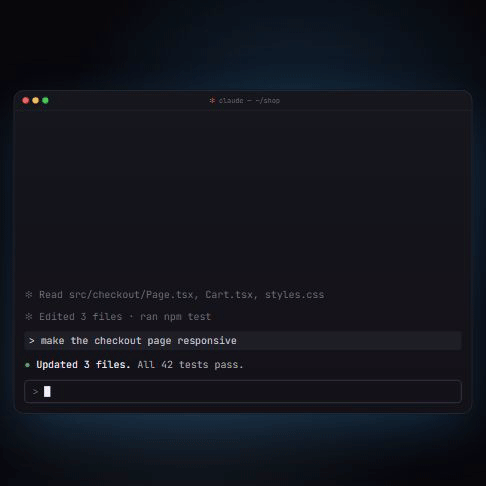
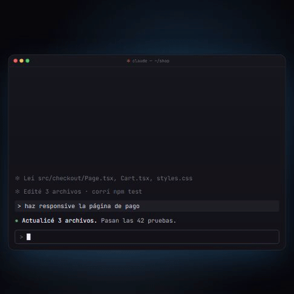

# Then

**A Claude mod** for Claude Code: what's next, one keystroke away.

**English** · [Español](#español)

<p align="center">
  
  <br>
  <a href="https://github.com/gaboxdev/then/releases/download/v0.8.0/then-en.mp4"><b>▶ Watch the full video with sound (37 s)</b></a>
</p>

Every time Claude finishes a turn, it leaves **4 numbered next steps above the prompt**, plus a fifth one that is yours to write. Type the number and it goes. No more "what should I do next?" at the end of every answer.

```
◆ What next?   type the number · box or + for several
                                                                        usage ▾
  1  Test it in the browser               open the page and check it    ▮▯▯ low
  2  Commit my own files     ★ suggested  only this session's files     ▮▮▯ med
  3  Write a check script                 a script that verifies it     ▮▮▮ high
  4  Leave it as is                       nothing else to do            ▯▯▯ none
  5  Something else                       none of these: type your own
```

- **One keystroke.** With the prompt empty, type `3` and option 3 is sent at once, no Enter.
- **Or say it.** `the 3`, `2 and 4`, `2 but skip the tests` + Enter also work (Spanish too: `quiero la 3`, `la 2 y la 4`).
- **Several at once.** Tick the box beside each number you want, or type `+` and then the numbers (`+4 2`); the boxes fill as you go, and Enter sends them in that order.
- **Option 5 is free.** Type `5` and the band stays while you write your own request.
- **★ suggested** marks the one Claude recommends.
- **usage** shows what each option would spend in tokens and time: none, low, med, high.
- **Fits any width.** In a narrow terminal the band gives up the detail, then the words (the ★ and the bars stay), and every row still lines up.
- **Hover a long description** and it scrolls so you can read all of it (terminal fullscreen mode or the desktop app).
- **A soft chime** when a turn ends with options, so you can look away while Claude works (`/then sound off` mutes it).
- **Forgot?** If Claude ends a turn of real work without options, the mod sends it back once to add them.

## Install

At the prompt of a Claude Code session:

```
/plugin install then --marketplace gaboxdev/then
```

Answer `y` to add the marketplace, then pick the user scope. It works from the next turn on.

## Change the color

Type it at the prompt; the band repaints at once and the choice is remembered:

```
/then color            → shows the current color and the list
/then color violet     → blue, violet, green, amber, pink, cyan
/then color #D97757    → any #RRGGBB
/then color default    → back to the one in /config
```

## Settings

Everything else lives in `/config`, under the plugin (`/then color` wins over the color set here):

| Option | Values | Default |
|---|---|---|
| Language | `auto`, `español`, `english` | `auto` (follows Claude Code's language setting) |
| Band color | `blue`, `violet`, `green`, `amber`, `pink`, `cyan`, `custom` | `blue` |
| Custom color | any `#RRGGBB` | `#D97757` |

Every palette color keeps white text at 5:1 contrast or better; a light custom color gets dark text instead.

`/then` turns it off and on (`/then on`, `/then off`), `/then sound on|off` the chime; all remembered across sessions.

## What it costs

Then runs on your machine and calls no model of its own. It spends a few of Claude's tokens, measured on a real session:

| What | When | Tokens |
|---|---|---|
| Its rule in the system prompt | every request, cached after the first | ~260 |
| Claude writing the 4 options at the end of its reply | once per turn, output | ~50 |
| Your pick, sent along with your message | when you pick | ~35 |

That is all: the options ride at the end of Claude's own reply in a short block the mod reads and the transcript never draws, so there is **no tool call and no extra step** re-reading the conversation. If Claude forgets the options after real work, the mod asks once, and only that costs one more step.

Version 0.4 used a tool for this; moving to the block cut the fixed part in half (~540 → ~260), the per-turn output by two thirds (~145 → ~50), and removed the extra step, which in a 40k-token conversation cost about as much as 4k fresh input tokens every turn.

`/then off` removes all of it.

## How it works

It is a Claude mod (a Claude Code hooks module). It adds one short rule to the system prompt asking Claude to end each reply with a `<then>` block of 4 lines (`n|title|detail|usage`, a `*` on the suggested one). The mod reads that block when the reply is in, hides it from the transcript (the stored message keeps it, so Claude knows what it offered) and draws the band above the prompt; what you type is read before it reaches Claude, and the option you chose travels with your message as context. Nothing leaves your machine.

Made to sit next to [plan-progress](https://github.com/zycck/claude-mods), whose look it borrows.

---

## Español

**Then** es un Claude mod para Claude Code.

<p align="center">
  
  <br>
  <a href="https://github.com/gaboxdev/then/releases/download/v0.8.0/then-es.mp4"><b>▶ Ver el video completo con sonido (37 s)</b></a>
</p>

Cada vez que Claude termina un turno, deja **4 opciones numeradas para seguir encima del prompt**, más una quinta que escribes tú. Escribes el número y listo.

- **Una tecla.** Con el prompt vacío, escribe `3` y la opción 3 sale al instante, sin Enter.
- **O dilo.** `quiero la 3`, `la 2 y la 4`, `2 pero sin commit` + Enter también sirven.
- **Varias a la vez.** Marca la casilla al lado de cada número que quieras, o escribe `+` y luego los números (`+4 2`); las casillas se llenan mientras eliges, y Enter las manda en ese orden.
- **La 5 es libre.** Escribe `5` y la banda se queda mientras escribes lo tuyo.
- **★ sugerida** marca la que Claude recomienda.
- **consumo** dice cuánto gastaría cada opción en tokens y tiempo: nada, bajo, medio, alto.
- **Se adapta al ancho.** En una terminal angosta la banda suelta el detalle y luego las palabras (quedan la ★ y las barras), y las filas siguen alineadas.
- **Pasa el mouse sobre una descripción larga** y se desplaza para leerla entera (modo pantalla completa de la terminal o la app de escritorio).
- **Suena suave** cuando un turno termina con opciones, para que puedas mirar otra cosa mientras Claude trabaja (`/then sonido off` lo calla).

### Instalar

```
/plugin install then --marketplace gaboxdev/then
```

Responde `y` para agregar el mercado y elige el alcance de usuario.

### Ajustes

**Cambiar el color**, escribiéndolo en el prompt (se ve al instante y se recuerda):

```
/then color            → muestra el color actual y la lista
/then color violeta    → azul, violeta, verde, ámbar, rosa, cian
/then color #D97757    → cualquier #RRGGBB
/then color normal     → vuelve al de /config
```

En `/config` están el idioma (`auto`, `español`, `english`) y el color por defecto. `/then` lo apaga y lo prende (`/then on`, `/then off`) y `/then sonido on|off` maneja el sonido.

### Cuánto consume

Then corre en tu máquina y no llama a ningún modelo propio. Gasta pocos tokens de Claude, medidos en una sesión real:

- **Fijo, en el prompt de sistema:** ~260 tokens (la regla). Queda en caché después de la primera petición.
- **Por turno:** ~50 tokens de salida, Claude escribiendo las 4 opciones al final de su respuesta.
- **Al elegir:** ~35 tokens que viajan con tu mensaje.
- **Sin paso extra:** las opciones van en un bloque corto al final de la respuesta, que el mod lee y no se dibuja. No hay llamada a herramienta ni un paso más que vuelva a leer la conversación. Solo si Claude las olvida después de trabajar, el mod le pide una vez que las ponga.

Frente a la versión 0.4 (que usaba una herramienta): la parte fija bajó a la mitad (~540 → ~260), la salida por turno a un tercio (~145 → ~50) y desapareció el paso extra, que en una conversación de 40k tokens costaba como 4k tokens de entrada en cada turno.

`/then off` lo quita todo.

## License

MIT
